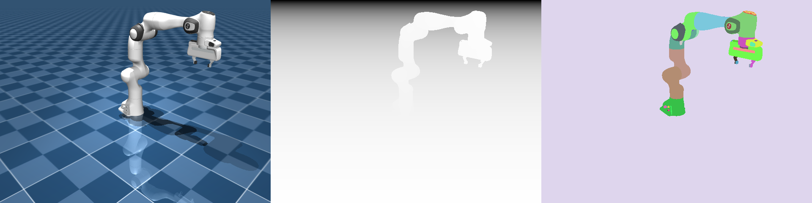
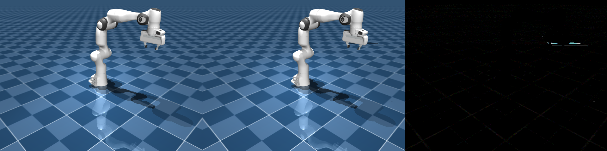

# InstinctRender on MI355X: results

Physical AI simulators draw through OpenGL. MI355X (gfx950) has no
fixed-function graphics hardware, so those simulators cannot render on it with
the usual AMD OpenGL stack. [InstinctRender](https://github.com/AMD-BRAIN-Internal/InstinctRender/tree/instinct)
is an internal Mesa fork whose `instinct` driver implements OpenGL as HIP
compute kernels, which is the reason to try it: keep MuJoCo and similar
applications unchanged and still get a picture, depth and segmentation off an
MI355X.

This note is the first bring-up from [PLAN.md](PLAN.md). The driver was built
on one shared MI355X node, then checked with a small OpenGL scene, four Piglit
tests and a MuJoCo Franka Panda, each compared with the `llvmpipe` CPU renderer
from the same Mesa source.

## Test setup

- Node: `smci355-ccs-aus-r17-22`, 8x gfx950 (MI355X), ROCm 7.2, Ubuntu 24.04.
- Source: `InstinctRender` branch `instinct`, commit `c2eaf9cd`
  ("instinct: address CodeQL findings"), Mesa 26.2.3 base.
- Build: release, LLVM 19.1.1, meson 1.12.1, MuJoCo 3.3.7.
- Build steps are in [PLAN.md](PLAN.md). Build logs are not in this folder.

## Summary

- The `instinct` driver builds, installs and runs on MI355X. `eglinfo` reports
  OpenGL 4.5 core/compat and GLES 3.2 with the renderer
  `instinct (HIP gfx950, experimental)`.
- Results match the llvmpipe CPU reference from the same source for the
  synthetic scene and the Piglit tests. The MuJoCo Panda RGB image differs from
  llvmpipe on about 1% of pixels (the RGB result below). Depth and segmentation
  are bit-exact.
- Steady-state MuJoCo render time: about 55 ms per 640x480 frame, 18 FPS.
  llvmpipe takes about 88 to 96 ms at the same size, and about 114 ms at 1080p.
  These numbers come from a small number of runs; see the caveats.

## 1. Driver selection

`eglinfo -B` with `EGL_PLATFORM=surfaceless` and `GALLIUM_DRIVER=instinct`:

```
OpenGL core profile renderer: instinct (HIP gfx950, experimental)
OpenGL core profile version: 4.5 (Core Profile) Mesa 26.2.3 (git-c2eaf9cd7a)
OpenGL ES profile version: OpenGL ES 3.2 Mesa 26.2.3 (git-c2eaf9cd7a)
```

## 2. Synthetic smoke test (`scripts/gl_smoke.py`)

A 512x512 scene: an interpolated triangle, two overlapping depth-tested quads,
and a mipmapped checkerboard texture, rendered with 4x MSAA and resolved.

| Comparison | Result |
|---|---|
| instinct vs llvmpipe | Max abs diff 0, PSNR 168 dB (bit-identical) |


## 3. Piglit regression checks

Run with `PIGLIT_PLATFORM=surfaceless_egl PIGLIT_NO_WINDOW=1` and `-auto -fbo`.

| Test | instinct | llvmpipe |
|---|---|---|
| `gl-1.0-scissor-clear` | pass | pass |
| `gl-1.0-scissor-depth-clear` | pass | pass |
| `depthrange-clear` | pass | pass |
| `dlist-clear` | pass | pass |

This is only the four tests the driver documentation names as its initial
regression checks. It is not the full dEQP or Piglit suite.

## 4. MuJoCo 3.3.7 Franka Panda (`scripts/mujoco_render.py`)

Scene: `mujoco_menagerie/franka_emika_panda/scene.xml`, 640x480, free camera
with a slow orbit in the video. Output is RGB, depth and segmentation.

| Output | instinct vs llvmpipe |
|---|---|
| RGB | Max abs diff 76, mean 0.15, 1.14% of pixels differ by more than 2, PSNR 42.4 dB |
| Depth (8-bit visualization) | Bit-identical |
| Segmentation | Bit-identical |

In the amplified diff, the RGB differences appear as faint edges along the floor
grid lines and a few highlight pixels on the gripper. I looked at the diff image
only and did not investigate the cause. The driver docs say MuJoCo image
comparisons still have unresolved differences, so this matches the known status.





Animated output (8 s, 30 fps, 240 frames): [`results/panda_instinct.mp4`](results/panda_instinct.mp4).

## 5. Performance

Wall-clock time per frame, RGB render plus readback, after the first frame.
Each figure is from one run of `mujoco_render.py`.

| Resolution | Driver | Frames | Time per frame | FPS |
|---|---|---|---|---|
| 640x480 | instinct | 200 (after warm-up) | 55.0 ms | 18 |
| 640x480 | instinct | 100 | 109.9 ms | 9 |
| 640x480 | instinct | 400 | 106.7 ms | 9 |
| 640x480 | llvmpipe | 100 | 95.7 ms | 10 |
| 640x480 | llvmpipe | 400 | 87.7 ms | 11 |
| 1920x1080 | instinct | 400 | 79.8 ms | 13 |
| 1920x1080 | llvmpipe | 400 | 114.0 ms | 9 |

Caveats:

- The instinct 640x480 runs differed by about 2x (55 ms and 107 ms). I did not
  find the cause. Possible factors include the node being shared (GPU contention)
  and differences in shader-cache state; I did not test either. Treat the numbers
  as indicative, not as a benchmark.
- The first frame in a fresh shader cache took 6 to 16 seconds, because hipRTC
  compiles the shaders. Warm runs start in about 100 ms.
- llvmpipe ran on a 256-core CPU, so its numbers depend on the host's CPU
  count.

Driver counters for one warm 640x480 frame (`INSTINCT_PROFILE=1`): 384 draws,
5 clears, 6 framebuffer epochs, 76 kernel launches, one 9.5 MB arena upload,
CPU submission about 0.7 ms, and completion observed about 53 ms after
submission. The CPU side is negligible, so most of the time is GPU execution.
These are driver counters, not GPU kernel timings.

## Issues seen

- MuJoCo prints `MESA-EGL: warning: Not allowed to force software rendering when
  API explicitly selects a hardware device.` on both drivers. Rendering still ran
  on the selected driver, confirmed by the GL renderer string. I did not
  investigate the warning further.
- In a quick renderer-string check I wrote, which did not call `close()`, the
  MuJoCo context printed `EGLError` tracebacks during interpreter shutdown. The
  test scripts use `with mujoco.Renderer(...)`, and their output was not
  affected. The repo's benchmark notes (`bench/workloads.toml`) record the same
  teardown issue with MuJoCo 3.3.7's public `Renderer.close`.

## Not done

- Full dEQP (GLES2/3/3.1, GL 4.5 mustpass) and Piglit suites, which need dEQP built
  separately.
- Genesis and Newton renderers.
- A repeatable benchmark with fixed frame counts across several runs.
- Interactive VNC viewing (see `PLAN.md`).

## Files

- `scripts/gl_smoke.py`: synthetic EGL test (`--out`, `--size`, `--samples`).
- `scripts/mujoco_render.py`: MuJoCo RGB, depth and segmentation, timing, and an
  optional MP4 (`--video-frames`).
- `scripts/compare.py`: diff and PSNR between two images.
- `scripts/instinct-env.sh`: environment for the private Mesa prefix.
- `results/`: all PNG and MP4 outputs referenced above.
